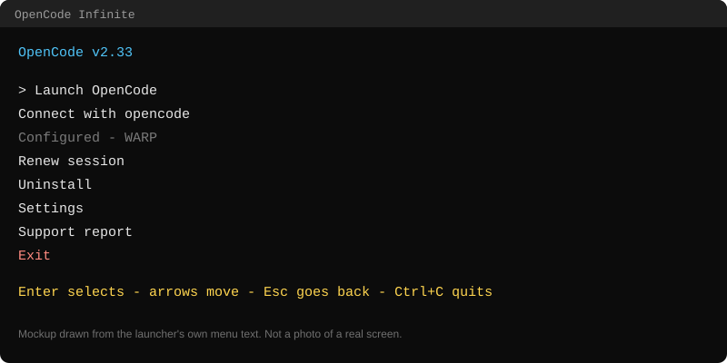
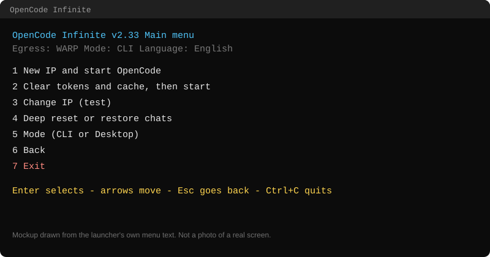

# OpenCode Infinite

A single-file Windows launcher for [OpenCode](https://opencode.ai). It starts
OpenCode through a different exit IP, installs what is missing, and when a
free-tier limit stops your chat, it gets a new IP and resumes the same chat.





> The two images above are drawn from the launcher's own menu text, not
> photos of a real screen.

- **File:** `OpenCode Infinite.bat` (one file, no installer, no services)
- **Windows:** 10 and 11, x64, ARM64, and 32-bit (x86, limited, see below)
- **Admin:** only for the optional WARP install (UAC). Everything else runs as
  your user.

---

## Contents

1. [What it does](#1-what-it-does)
2. [Install](#2-install)
3. [First run](#3-first-run)
4. [Menus](#4-menus)
5. [Connection modes](#5-connection-modes)
6. [Automatic IP hunt](#6-automatic-ip-hunt)
7. [Deep reset and restore](#7-deep-reset-and-restore)
8. [Settings](#8-settings)
9. [Languages](#9-languages)
10. [Keys and commands](#10-keys-and-commands)
11. [Updates](#11-updates)
12. [Files and folders](#12-files-and-folders)
13. [Troubleshooting](#13-troubleshooting)
14. [Verify the file](#14-verify-the-file)

---

## 1. What it does

Free-tier AI endpoints limit usage per IP address and per chat. The launcher:

1. starts OpenCode with an egress (Cloudflare WARP, Tor, a proxy list, or your
   direct connection), so the provider sees that exit IP;
2. when a limit or a dead chat is detected in the OpenCode log, it stops the
   OpenCode window, gets a new IP, and resumes the chat with `continue`;
3. can probe each new IP with one cheap message on a throwaway session, so
   IPs that are already burned are skipped;
4. installs what is missing (WARP, OpenCode, Tor, 32-bit Node.js) with a size
   check and a SHA-256 check on every download.

Nothing is installed silently. Every install asks first, and UAC is shown to
you.

---

## 2. Install

**PowerShell or Windows Terminal (recommended):**

```powershell
[Net.ServicePointManager]::SecurityProtocol='Tls12'; iwr https://github.com/jeko1107/opencode-infinite/releases/latest/download/OpenCode-Infinite.bat -UseBasicParsing -OutFile "$env:TEMP\oci.bat"; Copy-Item "$env:TEMP\oci.bat" "$env:USERPROFILE\Desktop\OpenCode Infinite.bat" -Force; & "$env:TEMP\oci.bat"
```

**cmd (`curl.exe` ships with Windows 10 1803 and later):**

```cmd
curl.exe -f -L https://github.com/jeko1107/opencode-infinite/releases/latest/download/OpenCode-Infinite.bat -o "%USERPROFILE%\Desktop\OpenCode Infinite.bat" && "%USERPROFILE%\Desktop\OpenCode Infinite.bat"
```

**Old copy?** Run `Update launcher.bat` from the repository in the same folder.
It downloads the latest release and replaces the old copy.

---

## 3. First run

1. Double-click `OpenCode Infinite.bat`.
2. Pick **CLI** (the terminal interface) or **Desktop** (the OpenCode app).
3. Pick the egress mode (section 5). If WARP or OpenCode is missing, the
   launcher offers to install it.
4. Pick a folder to work in (CLI only). Dragging a folder onto the `.bat`, or
   passing the path as an argument, skips this step.
5. The main menu opens. Choose **1 New IP and start OpenCode**.

Use **Connect with opencode** on the home screen once. It creates the
`opencode` command, the shortcuts, and the terminal commands (section 10), so
you can start OpenCode through the same connection without the launcher menus.

---

## 4. Menus

**Home screen**

| Option | What it does |
|---|---|
| Launch OpenCode | Pick a folder and a connection, then start the CLI or the desktop app |
| Connect with opencode | Guided setup. Creates the `opencode` command and shortcuts. Shows "Configured" once done |
| Renew session | Closes OpenCode, saves and clears the saved tokens, and gets a new IP. Use it when the limit is hit or the login expired |
| Uninstall | Removes only what setup added (command, shortcuts, PATH entry) and restores the settings it changed. Asks first |
| Settings | Every launcher option, grouped (section 8) |
| Support report | Collects versions, settings and the recent log into one text file. Passwords, tokens and your user name are removed. IPs are masked by default |
| Exit | Closes the launcher |

**Main menu** (shown after you start from Launch OpenCode)

| Key | Option | What it does |
|---|---|---|
| `1` | New IP and start OpenCode | Gets a new IP or proxy, then opens OpenCode. Chats stay as they are |
| `2` | Clear tokens and cache, then start | Kills OpenCode, saves the login file to the Desktop, clears the cache, then opens OpenCode. Chats stay where they are |
| `3` | Change IP (test) | Rotates the connection only, without opening OpenCode |
| `4` | Deep reset or restore chats | Submenu, section 7 |
| `5` | Mode (CLI or Desktop) | Switches between the terminal and the desktop app |
| `6` | Back | Returns to the home screen |
| `7` | Exit | Closes the launcher |

Inside every menu, `Esc` goes back. `Ctrl+C` quits the launcher.

---

## 5. Connection modes

The egress is chosen once per start.

| Mode | How it works | Notes |
|---|---|---|
| **WARP** | Cloudflare WARP local proxy. A new IP is a new WARP registration | Rotation supported. Needs WARP (installed on request) |
| **TOR** | Portable Tor (Tor Browser's expert bundle) plus a built-in HTTP bridge on `127.0.0.1:8118` | No Privoxy needed. A Tor that is already running (Tor Browser on 9150, or 9050) is used as it is and never closed by the launcher |
| **PROXY** | Free HTTP proxies from a list (default: ProxyScrape). Dead ones are skipped | Use your own list with `PROXY_LIST_URL` (URL or local file; plain text, CSV, JSON, XML or HTML) |
| **NONE** | Direct connection, no proxy | Nothing to rotate |

The proxy settings apply only to the OpenCode process tree. The rest of your
system (browser, other apps) stays direct.

**32-bit Windows (x86):** WARP and the desktop app are not available. OpenCode
runs through npm with a 32-bit Node.js.

---

## 6. Automatic IP hunt

When a chat hits a limit, the launcher hunts for a new IP:

- **Target:** `TARGET_COUNTRY` (for example `DE`) and/or `TARGET_PREFIX`
  (for example `104.28.`). Both empty means any new IP.
- **Caps:** `TARGET_TRIES` attempts, `TARGET_MINUTES` minutes, and
  `TARGET_INTERVAL` seconds between attempts.
- Every attempt prints its number, the IP, the country, and whether it matches.
  The hunt ends with a summary (target reached, or which cap stopped it).
- `Esc` or `Q` during the wait stops the hunt and returns to the menu.
- `AUTO_ROTATE=0` turns the automatic hunt off, and the menu decides. The `R`
  key at the closed prompt always rotates.

---

## 7. Deep reset and restore

Deep reset is the only option that moves your chats. It asks first.

1. Stops OpenCode.
2. Moves `opencode.db` (and its `-wal` / `-shm` files) and the `storage` folder
   to `Desktop\opencode_chats_archiviate\<date-time>\`. Each reset gets its own
   folder. Nothing is deleted.
3. Clears tokens and the cache.
4. Starts a fresh session.

**Restore chats** (`4` then `2`, or *Deep reset or restore chats* then *Restore
chats*): lists the archived folders, newest first. Pick one and the launcher:

1. stops OpenCode;
2. moves the chats in place now to `Desktop\opencode_chats_before_restore\<random>\`;
3. copies the database and storage back from the chosen folder;
4. starts OpenCode.

Login tokens are not restored. Sign in again if OpenCode asks.

---

## 8. Settings

Open **Settings** on the home screen. The groups are: Connection, Proxy list,
Tor, Rotation, Watcher, Probe, Paths, Updates, Appearance, Shortcuts and
Support. A `*` marks a value you changed. `Enter` edits or toggles the
selected value. Changes are saved at once.

The Settings menu also has **Export** and **Import** (one `.json` file; every
value is checked first, and one wrong value stops the whole import), and
**Reset to default values** (asks first).

Main settings and their defaults:

| Setting | Default | Meaning |
|---|---|---|
| `ON_CLOSE` | `ask` | After OpenCode closes: `ask` (R new IP and resume, M menu, Q quit) or `quit` |
| `AUTO_ROTATE` | `1` | Automatic IP hunt after a limit (`0` = off) |
| `TARGET_COUNTRY` | empty | Country code the hunt looks for, e.g. `DE` |
| `TARGET_PREFIX` | empty | Start of an IPv4 the hunt looks for, e.g. `104.28.` |
| `TARGET_TRIES` | `1` | Attempts per hunt (1-100) |
| `TARGET_MINUTES` | `15` | Time per hunt (1-240) |
| `TARGET_INTERVAL` | `15` | Seconds between attempts (0-300) |
| `ROTATE_TRIES_MAX` | `4` | Rotation attempts on the WARP, Tor and proxy paths |
| `ROTATE_COOLDOWN` | `10` | Seconds between WARP registrations (Cloudflare rate-limits fast ones) |
| `IP_FIND_MAX` | `0` | Burned IPs a hunt may reject (`0` = no limit; the attempt cap still applies) |
| `WATCH` | `1` | Watch the OpenCode log for limit errors |
| `RESUME_MSG` | `continue` | Message sent when a chat is resumed |
| `RESUME_TIMEOUT` | `90` | Seconds before a stuck resume is killed and the launcher rotates |
| `PROBE` | `1` | Probe each new IP with one cheap message |
| `PROBE_MODEL` | `opencode/big-pickle` | Model used for the probe |
| `UPDATE_CHECK` | `1` | Check for updates on start (asks Y/N, section 11) |
| `PROXY_LIST_URL` | ProxyScrape free HTTP list | Your proxy list (URL, `file:///` or a local path) |
| `PROXY_PORT` | `40000` | WARP local proxy port |
| `TOR_SOCKS_PORT` / `TOR_HTTP_PORT` | `9050` / `8118` | Tor SOCKS port and the bridge HTTP port |
| `TOR_AUTO_INSTALL` | `1` | Download the portable Tor bundle when none is running |
| `TOR_BOOTSTRAP_WAIT` | `120` | Seconds to wait for Tor to connect |
| `LOG_ENABLED` / `LOG_MAX_KB` | `1` / `1024` | Launcher log on/off and its size limit (the log is trimmed to its newest part) |
| `LOG_MASK_IP` | `1` | Mask public IPs in the support report |
| `OCUI_LANG` | `auto` | Language (section 9) |
| `OCUI_THEME` | `ocean` | Colors: ocean, forest, sunset, mono, rainbow |
| `KEY_ROTATE` / `KEY_MENU` / `KEY_QUIT` | `R` / `M` / `Q` | One-letter keys for the closed prompt (must differ) |

The Windows Terminal and console font can be set from **Settings, Appearance**
too. The launcher keeps the original font and restores it when you ask.

---

## 9. Languages

Pick the language in **Settings, Appearance, Language**. `auto` follows
Windows.

English, Español, Français, Deutsch, Português, Italiano and Türkçe.

Each language is a JSON file in the `langs` folder of this repository. The
launcher downloads only the file you chose, refreshes it at most once a day, and
keeps English built in as the fallback. Logs and the support report stay in
English.

---

## 10. Keys and commands

| Key | Where | Action |
|---|---|---|
| `Enter` | menus | Select |
| Arrows | menus | Move |
| `Esc` | menus, prompts | Back |
| `Ctrl+C` | anywhere | Quit the launcher. It stops the processes it started and leaves the window open |
| `R`, `M`, `Q` | closed-OpenCode prompt | New IP and resume, menu, quit (letters are editable in Shortcuts) |

Commands created by **Connect with opencode**. They work in any terminal:

| Command | What it does |
|---|---|
| `opencode` | Starts OpenCode through the saved connection |
| `opencodeinf` | Opens the launcher menu again |
| `opencodeoc` | Starts the OpenCode you had before the launcher, with no connection. Use it when the launcher breaks |
| `OpenCode Infinite.bat --run` | Quick start with the saved connection |

Start the launcher in a folder: drag the folder onto the `.bat`, or run
`OpenCode Infinite.bat "D:\work\project"`. UNC paths work too.

---

## 11. Updates

On start, with `UPDATE_CHECK=1`, the launcher checks for:

- **A newer launcher** in this repository. It shows `update found` and asks
  `[Y/N]`. On `Y` it backs up the current file, swaps in the new one, and
  restarts.
- **A newer OpenCode** on opencode.ai (official release metadata, SHA-256
  checked). It asks `[Y/N]`, closes every OpenCode process, then installs. The
  update uses the same channel as the running command: npm or the standalone
  build.
- **A newer OpenCode Desktop** (Desktop mode only). Same flow, with the silent
  installer.

No network, or an unreadable version, changes nothing. The checks run directly,
without the WARP proxy.

---

## 12. Files and folders

| Path | Purpose |
|---|---|
| `%USERPROFILE%\.local\share\opencode\` | OpenCode data (chats, database). Owned by OpenCode |
| `%LOCALAPPDATA%\opencode-infinite\` | Launcher state folder |
| `...\opencode-infinite\app\` | The launcher copy that the `opencode` commands run |
| `...\opencode-infinite\config.env`, `config.json` | Your settings |
| `...\opencode-infinite\langs\` | Language files |
| `...\opencode-infinite\launcher.log` | Launcher log (trimmed at `LOG_MAX_KB`) |
| `...\opencode-infinite\reports\` | Support reports |
| `...\opencode-infinite\tor\` | Portable Tor (TOR mode only) |
| `Desktop\opencode_chats_archiviate\` | Chats archived by deep reset |
| `Desktop\opencode_chats_before_restore\` | Chats moved aside by restore |

Environment variables are used for every path. No user name is written into the
file.

---

## 13. Troubleshooting

| Symptom | What to do |
|---|---|
| The menu shows an old version or old text | Run `Update launcher.bat`, or accept the update prompt. Translations come from the repository, so they update on the next start |
| `Terminate batch job (Y/N)?` | You pressed `Ctrl+C` in a batch context. Answer `N`, or use `Ctrl+C` again |
| Rotation keeps failing on WARP | Open `Renew session` from the home screen. Check `wcli.log` in the state folder for the daemon's own reason |
| TOR says it is not up after 120 s | Raise `TOR_BOOTSTRAP_WAIT`. The last `tor.log` lines are printed with the message |
| Your custom proxy list is ignored | One proxy per line (`ip:port` or `http://ip:port`). For a short list set `PROXY_LIST_MIN_BYTES=0` |
| `Another OpenCode launcher seems to be running` | A leftover lock from a Ctrl+C. `Y` is safe |
| OpenCode does not open after a change | Start `opencodeoc` to reach OpenCode, then send the support report |
| Font change does not show | Reopen the tab. Some terminals keep their own font setting (VS Code: `terminal.integrated.fontFamily`) |

For anything else, open **Support report** from the home screen and attach the
file to an issue.

---

## 14. Verify the file

```cmd
certutil -hashfile "OpenCode Infinite.bat" SHA256
```

The shipped copy of this version hashes to:

`54B55209B3BF19EB315F42E0BFA48DA628865F3C70BA27C6D0B0ABEC62D3AF44`

A different hash means the file is not the shipped copy. Download it again
with the install command in section 2.

### Antivirus

Some engines flag batch launchers as heuristic detections. The usual reasons:
the launcher writes temporary files, downloads installers and runs them after
checking their hash, and starts hidden PowerShell helpers. The launcher does not
write registry keys, services, scheduled tasks or startup entries, and it removes
its temporary files on exit. Hash-check the file, and if an engine still flags
it, submit the hash to that vendor as a false positive.

The network hosts it uses are GitHub (updates, the launcher), `opencode.ai`
(OpenCode), `downloads.cloudflareclient.com` (WARP), `nodejs.org` (32-bit
Node.js), `dist.torproject.org` (Tor, TOR mode), `www.cloudflare.com` (IP
check), and the proxy list you choose.

---

**jeko1107** - https://github.com/jeko1107/opencode-infinite
