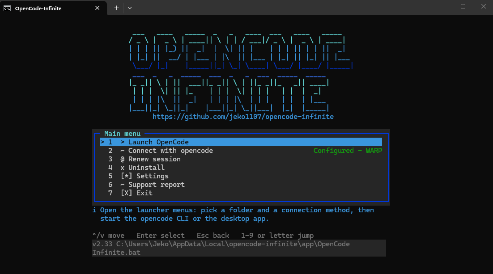
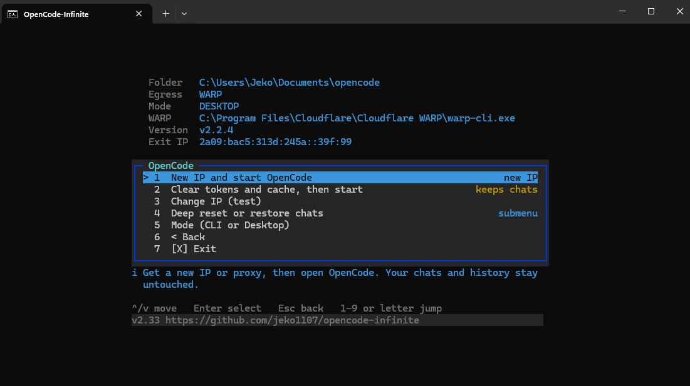
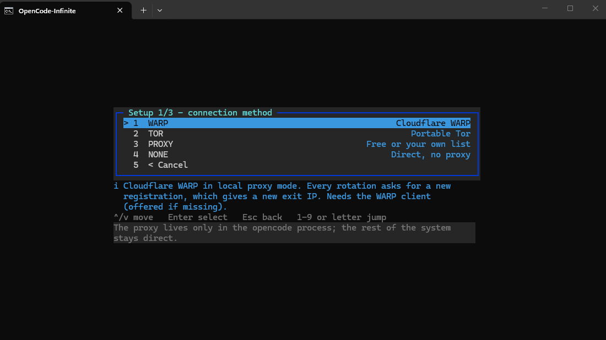
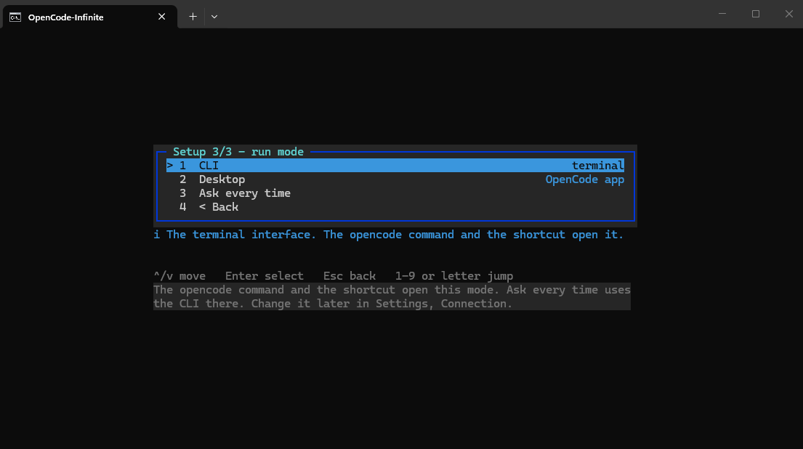
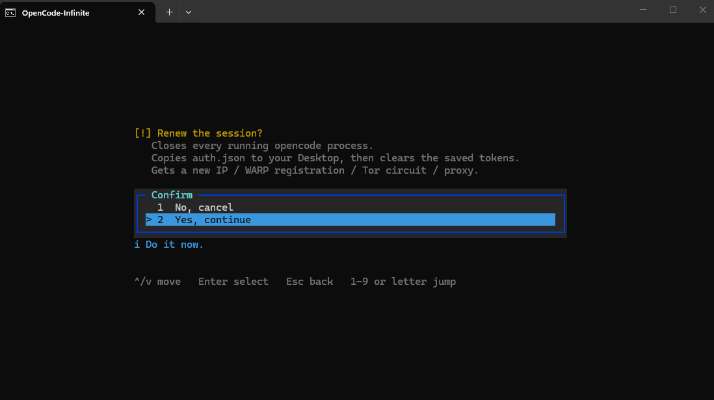
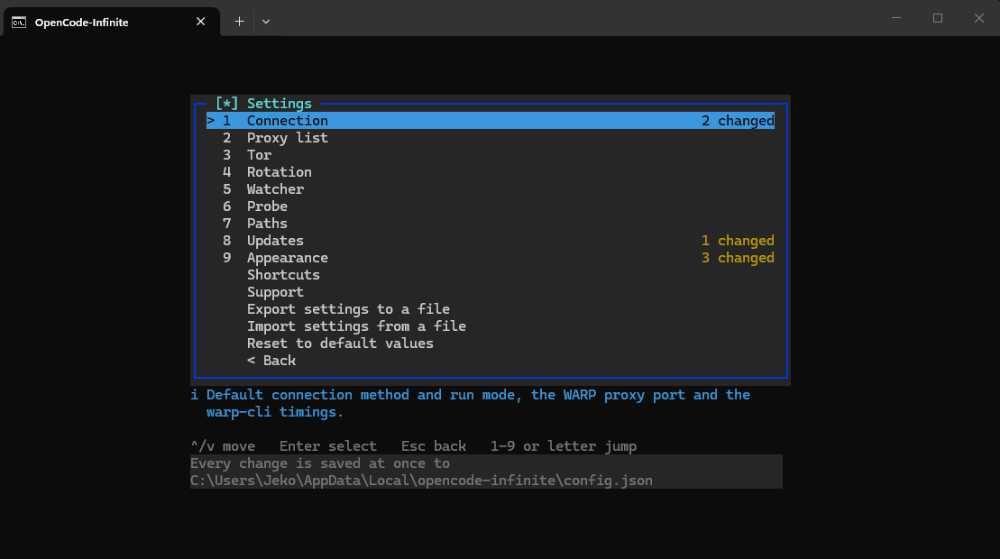
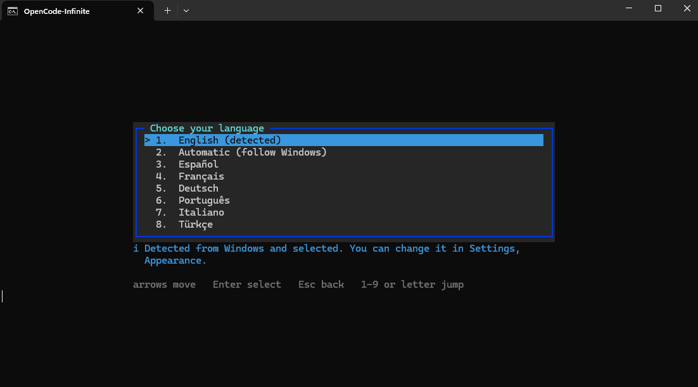

# OpenCode Infinite

A single-file Windows launcher for [OpenCode](https://opencode.ai). It starts
OpenCode through a different exit IP. When a free-tier limit stops your chat, it
gets a new IP and resumes the same chat.

- **File:** `OpenCode Infinite.bat`. One file, no installer, no services.
- **Windows:** 10 and 11, x64, ARM64, and 32-bit (x86, limited: no WARP and no desktop app).
- **Admin:** only for the optional WARP install (UAC). Everything else runs as your user.


---

## Contents

1. [Install](#1-install)
2. [First run](#2-first-run)
3. [Menus](#3-menus)
4. [Connection modes](#4-connection-modes)
5. [Automatic IP hunt](#5-automatic-ip-hunt)
6. [Renew session](#6-renew-session)
7. [Deep reset and restore](#7-deep-reset-and-restore)
8. [Settings](#8-settings)
9. [Languages](#9-languages)
10. [Keys and commands](#10-keys-and-commands)
11. [Updates](#11-updates)
12. [Files and folders](#12-files-and-folders)
13. [Troubleshooting](#13-troubleshooting)

---

## 1. Install

**PowerShell or Windows Terminal (recommended):**

```powershell
[Net.ServicePointManager]::SecurityProtocol='Tls12'; iwr https://github.com/jeko1107/opencode-infinite/releases/latest/download/OpenCode-Infinite.bat -UseBasicParsing -OutFile "$env:TEMP\oci.bat"; Copy-Item "$env:TEMP\oci.bat" "$env:USERPROFILE\Desktop\OpenCode Infinite.bat" -Force; & "$env:TEMP\oci.bat"
```

**cmd** (`curl.exe` ships with Windows 10 1803 and later):

```cmd
curl.exe -f -L https://github.com/jeko1107/opencode-infinite/releases/latest/download/OpenCode-Infinite.bat -o "%USERPROFILE%\Desktop\OpenCode Infinite.bat" && "%USERPROFILE%\Desktop\OpenCode Infinite.bat"
```

To update an old copy, run `Update launcher.bat` from this repository in the same folder. It downloads the latest release and replaces the old file.

---

## 2. First run

1. Double-click `OpenCode Infinite.bat`.
2. Pick a language (section 9). `Automatic` follows Windows.
3. Choose **Connect with opencode** on the home screen. It asks for a connection method (section 4) and a run mode, then creates the `opencode` command and the shortcuts (section 10).
4. Choose **Launch OpenCode**, pick a folder and a connection, and start.

If WARP, Tor or OpenCode is missing, the launcher offers to install it. Nothing is installed without asking, and UAC is shown to you.



---

## 3. Menus

### Home screen

| Option | What it does |
|---|---|
| Launch OpenCode | Picks a folder and a connection, then starts the CLI or the desktop app |
| Connect with opencode | Guided setup. Creates the `opencode` command and the shortcuts. Shows `Configured` when done |
| Renew session | Closes OpenCode, copies `auth.json` to the Desktop, clears the saved tokens and gets a new IP (section 6) |
| Uninstall | Removes only what setup added (command, shortcuts, PATH entry) and restores the settings it changed. Asks first |
| Settings | Every launcher option (section 8) |
| Support report | Writes one text file with versions, settings and the recent log, for help. Passwords and tokens are removed. IPs are masked by default |
| Exit | Closes the launcher |

### Main menu

Opened after **Launch OpenCode**. It shows the folder, egress, mode, WARP version and exit IP.

| Key | Option | What it does |
|---|---|---|
| `1` | New IP and start OpenCode | Gets a new IP or proxy, then opens OpenCode. Chats stay as they are |
| `2` | Clear tokens and cache, then start | Stops OpenCode, saves the login file to the Desktop, clears the cache, then opens OpenCode. Chats stay |
| `3` | Change IP (test) | Rotates the connection only, without opening OpenCode |
| `4` | Deep reset or restore chats | Submenu (section 7) |
| `5` | Mode (CLI or Desktop) | Switches between the terminal and the desktop app |
| `6` | Back | Returns to the home screen |
| `7` | Exit | Closes the launcher |



---

## 4. Connection modes

The egress is chosen during setup and can be changed in Settings, Connection.

| Mode | How it works |
|---|---|
| **WARP** | Cloudflare WARP in local proxy mode. Every rotation registers again, which gives a new exit IP. Offered when WARP is missing |
| **TOR** | Portable Tor with a built-in HTTP bridge on `127.0.0.1:8118`. No Privoxy needed. A Tor that is already running (Tor Browser on port 9150, or 9050) is used as it is and never closed by the launcher |
| **PROXY** | Free HTTP proxies from a list (default: ProxyScrape). Dead ones are skipped. Use your own list with `PROXY_LIST_URL` |
| **NONE** | Direct connection, no proxy |

The proxy applies only to the OpenCode process. Your browser and other apps
stay direct.



**Run mode** is chosen the same way: **CLI** (terminal), **Desktop** (the OpenCode app), or **Ask every time**.



**32-bit Windows (x86):** WARP and the desktop app are not available. OpenCode runs
through npm with a 32-bit Node.js.

---

## 5. Automatic IP hunt

When a chat hits a limit, the launcher hunts for a new IP.

- **Target:** `TARGET_COUNTRY` (for example `DE`) and/or `TARGET_PREFIX` (for example `104.28.`). Both empty means any new IP.
- **Caps:** `TARGET_TRIES` attempts, `TARGET_MINUTES` minutes, and `TARGET_INTERVAL` seconds between attempts.
- Each attempt prints its number, the IP, the country and whether it matches. The hunt ends with a summary: target reached, or which cap stopped it.
- `Esc` or `Q` during the wait stops the hunt and returns to the menu.
- With `AUTO_ROTATE` off, the menu decides. The `R` key at the closed prompt always rotates.

---

## 6. Renew session

Use **Renew session** when the free limit is reached or the login has expired. It:

1. closes every running OpenCode process;
2. copies `auth.json` to your Desktop;
3. clears the saved tokens;
4. gets a new IP, WARP registration, Tor circuit or proxy.



---

## 7. Deep reset and restore

Option `4` in the main menu opens this submenu. It is the only option that moves your chats, and it asks first.

**Deep reset**

1. Stops OpenCode.
2. Moves the database (`opencode.db` with its `-wal` and `-shm` files) and the `storage` folder to `Desktop\opencode_chats_archiviate\<date-time>\`. Each reset gets its own folder. Nothing is deleted.
3. Clears tokens and the cache.
4. Starts a fresh session.

**Restore chats** lists the archived folders, newest first. Pick one and the launcher:

1. stops OpenCode;
2. moves the chats in place now to `Desktop\opencode_chats_before_restore\<random>\`;
3. copies the database and storage back from the chosen folder;
4. starts OpenCode.

Login tokens are not restored. Sign in again if OpenCode asks.

---

## 8. Settings

Open **Settings** from the home screen. The groups are: Connection, Proxy list, Tor,
Rotation, Watcher, Probe, Paths, Updates, Appearance, Shortcuts and Support. Each
group is numbered. A value that differs from the default is shown in yellow.
Enter edits or toggles the selected value. Every change is saved at once to
`config.json` in the state folder (section 12).



The Settings menu also has:

- **Export settings to a file**: one `.json` file with every changed setting.
- **Import settings from a file**: every value is checked first. One wrong value stops the whole import, so nothing is half changed.
- **Reset to default values**: asks first. Your connection setup is kept.

Main settings and their defaults:

| Setting | Default | Meaning |
|---|---|---|
| `ON_CLOSE` | `ask` | When OpenCode closes: `ask` (R new IP and resume, M menu, Q quit), or `quit` |
| `AUTO_ROTATE` | `1` | Automatic IP hunt after a limit (`0` = off) |
| `TARGET_COUNTRY` | empty | Country code to hunt for, e.g. `DE` |
| `TARGET_PREFIX` | empty | Start of an IPv4 to hunt for, e.g. `104.28.` |
| `TARGET_TRIES` | `1` | Attempts per hunt (1-100) |
| `TARGET_MINUTES` | `15` | Time per hunt, in minutes (1-240) |
| `TARGET_INTERVAL` | `15` | Seconds between attempts (0-300) |
| `ROTATE_TRIES_MAX` | `4` | Rotation attempts on the WARP, Tor and proxy paths |
| `ROTATE_COOLDOWN` | `10` | Seconds between WARP registrations |
| `IP_FIND_MAX` | `0` | Burned IPs a hunt may reject (`0` = no limit; the attempt cap still applies) |
| `WATCH` | `1` | Watch the OpenCode log for limit errors |
| `RESUME_MSG` | `continue` | Message sent when a chat is resumed |
| `RESUME_TIMEOUT` | `90` | Seconds before a stuck resume is stopped and the launcher rotates |
| `PROBE` | `1` | Probe each new IP with one cheap message |
| `PROBE_MODEL` | `opencode/big-pickle` | Model used for the probe |
| `UPDATE_CHECK` | `1` | Check for updates on start (section 11) |
| `PROXY_LIST_URL` | ProxyScrape free HTTP list | Your proxy list: a URL, `file:///`, or a local path |
| `PROXY_PORT` | `40000` | WARP local proxy port |
| `TOR_SOCKS_PORT` / `TOR_HTTP_PORT` | `9050` / `8118` | Tor SOCKS port and the bridge HTTP port |
| `TOR_AUTO_INSTALL` | `1` | Download the portable Tor bundle when no Tor is running |
| `TOR_BOOTSTRAP_WAIT` | `120` | Seconds to wait for Tor to connect |
| `OCUI_LANG` | `auto` | Language (section 9) |
| `OCUI_THEME` | `ocean` | Colors: `ocean`, `forest`, `sunset`, `mono`, `rainbow` |
| `OCUI_FONT` / `OCUI_FONT_SIZE` | empty / `16` | Terminal font and size (Windows Terminal, or the console) |
| `KEY_ROTATE` / `KEY_MENU` / `KEY_QUIT` | `R` / `M` / `Q` | Letter keys for the closed-OpenCode prompt. They must differ |
| `LOG_ENABLED` / `LOG_MAX_KB` | `1` / `1024` | Launcher log on or off, and its size limit. The log keeps its newest part |
| `LOG_MASK_IP` | `1` | Mask public IPs in the support report |

---

## 9. Languages

Pick the language in **Settings, Appearance, Language**. The list has
`Automatic` (follows Windows), English, Español, Français, Deutsch, Português,
Italiano and Türkçe.

Each language is a JSON file in the `langs` folder of this repository. The
launcher downloads only the file you chose, refreshes it at most once a day, and
keeps English built in as the fallback. Logs and the support report stay in English.

---

## 10. Keys and commands

| Key | Action |
|---|---|
| Arrows | Move through a menu |
| `Enter` | Select |
| `Esc` | Back, in every menu and prompt |
| `1`-`9` | Select a numbered option directly |
| `Ctrl+C` | Quit the launcher. It stops the processes it started and leaves the window open |
| `R`, `M`, `Q` | At the closed-OpenCode prompt: new IP and resume, menu, quit. The letters are editable in Settings, Shortcuts |

The commands created by **Connect with opencode** work in any terminal:

| Command | What it does |
|---|---|
| `opencode` | Starts OpenCode through the saved connection |
| `opencodeinf` | Opens the launcher menu |
| `opencodeoc` | Starts the OpenCode you had before the launcher, with no connection. Use it when the launcher breaks |

To start the launcher in a folder, drag the folder onto the `.bat`, or run
`OpenCode Infinite.bat "D:\work\project"`. UNC paths work too.
`OpenCode Infinite.bat --run` does a quick start with the saved connection.

---

## 11. Updates

With `UPDATE_CHECK=1`, every start checks three things:

- **A newer launcher** in this repository. It asks `[Y/N]`. On `Y`, it keeps a backup of the current file, replaces it and restarts.
- **A newer OpenCode** from opencode.ai (official release data, SHA-256 checked). It asks `[Y/N]`, closes every OpenCode process, then installs. It uses the same channel as the running command: npm or the standalone build.
- **A newer OpenCode Desktop** (Desktop mode only). Same flow, with the silent installer.

No network, or an unreadable version, changes nothing.

---

## 12. Files and folders

| Path | Purpose |
|---|---|
| `%USERPROFILE%\.local\share\opencode\` | OpenCode data: chats and database. Owned by OpenCode |
| `%LOCALAPPDATA%\opencode-infinite\` | Launcher state folder |
| `...\opencode-infinite\app\` | The launcher copy that the `opencode` commands run |
| `...\opencode-infinite\config.json` | Your settings |
| `...\opencode-infinite\langs\` | Language files |
| `...\opencode-infinite\launcher.log` | Launcher log |
| `...\opencode-infinite\reports\` | Support reports |
| `...\opencode-infinite\tor\` | Portable Tor (TOR mode only) |
| `Desktop\opencode_chats_archiviate\` | Chats archived by a deep reset |
| `Desktop\opencode_chats_before_restore\` | Chats moved aside by a restore |

---

## 13. Troubleshooting

| Symptom | What to do |
|---|---|
| The launcher shows old text or an old version | Run `Update launcher.bat`, or accept the update prompt on the next start |
| `Terminate batch job (Y/N)?` | You pressed `Ctrl+C` inside the launcher. Answer `N` to keep it running |
| WARP rotation keeps failing | Use **Renew session**. The daemon's own error text is in `wcli.log` in the state folder |
| TOR says it is not up after 120 s | Raise `TOR_BOOTSTRAP_WAIT`. The last `tor.log` lines are printed with the message |
| A custom proxy list is ignored | One proxy per line, as `ip:port` or `http://ip:port`. For a short list set `PROXY_LIST_MIN_BYTES=0` |
| `Another OpenCode launcher seems to be running` | A lock is left over from a `Ctrl+C`. `Y` is safe |
| OpenCode does not open | Run `opencodeoc` to reach OpenCode, then create a support report from the home screen |
| The font does not change | Reopen the tab. Windows Terminal keeps its font in its own `settings.json`. VS Code keeps it in `terminal.integrated.fontFamily` |

For anything else, create a **Support report** from the home screen and attach
the file to an issue.

---

**jeko1107** - https://github.com/jeko1107/opencode-infinite
